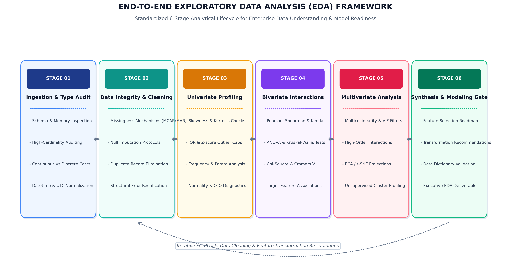
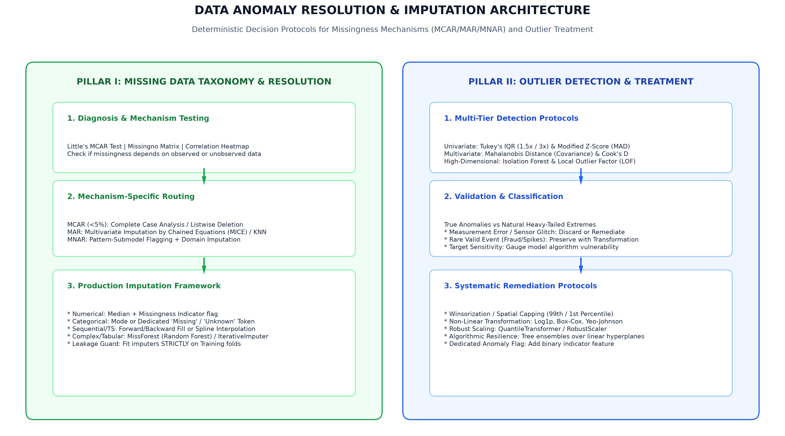
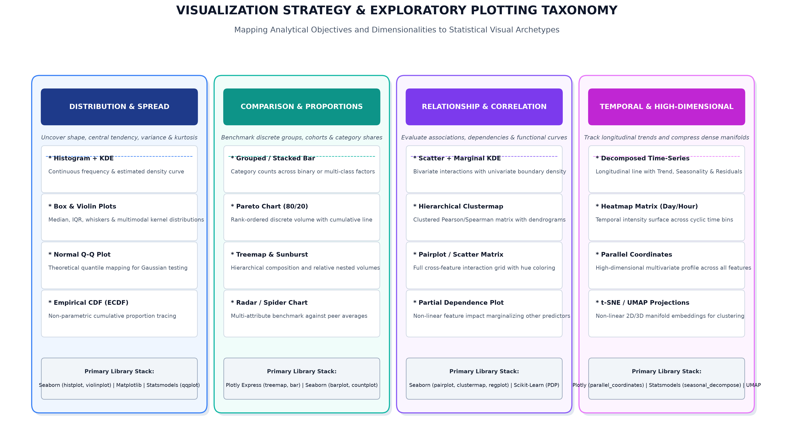
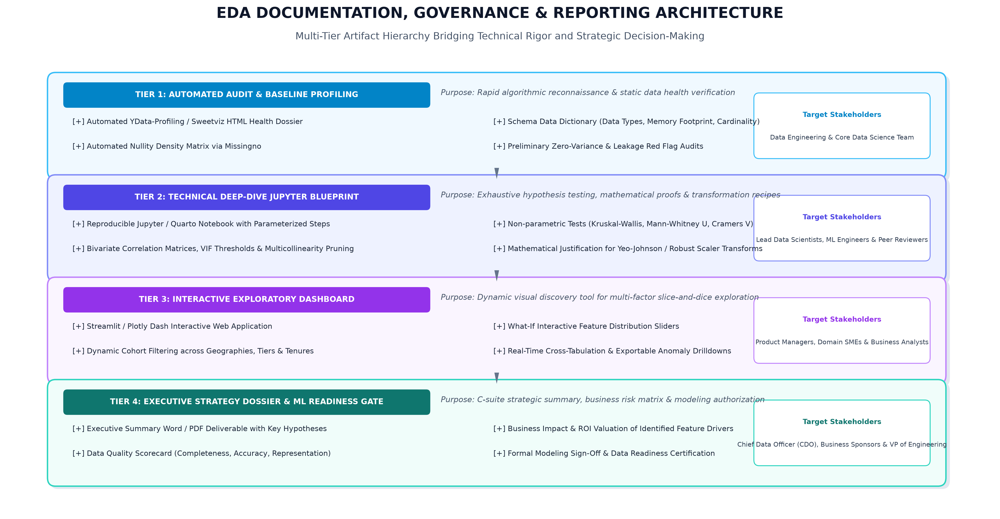

# Comprehensive Exploratory Data Analysis (EDA) and Visualization Framework Design

**Document ID:** EDA-DS-WK02-2026  
**Module:** Week 2: Exploratory Data Analysis (EDA) & Statistical Visualization Architecture  
**Author / Lead Data Scientist:** Laxmi Gupta  
**Project Domain:** Universal Data Science & Predictive Analytics Framework  
**Target Ecosystem:** Python 3.11+ | Pandas | NumPy | SciPy | Statsmodels | Matplotlib | Seaborn | Plotly | Missingno  
**Allocation Budget:** 33.0 Engineering Hours (30–35h Standard)  

---

## Executive Summary

Exploratory Data Analysis (EDA) serves as the foundational empirical cornerstone of any enterprise machine learning and statistical modeling initiative. Coined by mathematician John W. Tukey, EDA is not merely a collection of descriptive summaries or visual plots; it is an active investigative philosophy designed to expose underlying structures, isolate anomalies, test foundational assumptions, identify critical feature interactions, and rigorously validate data integrity before a single predictive model is trained.

In enterprise data science, skipping or expediting EDA directly incurs massive technical debt: downstream algorithms suffer from severe data leakage, bias amplification, distorted loss surfaces caused by undetected outliers, multicollinearity instability, and flawed imputations. This document outlines an industrial-grade, dataset-agnostic **Exploratory Data Analysis and Visualization Framework**. Designed to be adaptable to diverse tabular, temporal, and multi-modal schemas, this framework establishes a systematic 6-stage lifecycle, deterministic anomaly resolution protocols, an exhaustive visualization taxonomy, a curated Python library ecosystem, and a multi-tier governance reporting architecture.

---

## 1. Introduction & Theoretical Foundations of EDA

### 1.1 The Philosophy of Exploratory vs. Confirmatory Data Analysis
Traditional statistical practice relied predominantly on **Confirmatory Data Analysis (CDA)**, where formal hypotheses (null vs. alternative) are tested against data under rigid parametric assumptions. In contrast, **Exploratory Data Analysis (EDA)**, pioneered by John Tukey, operates on the premise that the data must be allowed to speak for itself before hypotheses are formalized.

```
       [Raw Data Ingestion]
                │
                ▼
   ┌───────────────────────────┐
   │ Exploratory Data Analysis │  ◄── "What is the data revealing?"
   │   (Empirical Discovery)   │      (Patterns, Anomalies, Distributions)
   └────────────┬──────────────┘
                │
                ▼
   ┌───────────────────────────┐
   │ Confirmatory Data Analysis│  ◄── "Is the observed effect statistically
   │    (Hypothesis Testing)   │      significant and generalizable?"
   └────────────┬──────────────┘
                │
                ▼
   ┌───────────────────────────┐
   │ Feature Engineering & ML  │  ◄── Model Training on Verified,
   │   (Predictive Modeling)   │      Sanitized Data Manifolds
   └───────────────────────────┘
```

EDA operates as an inductive, detective-like process:
1. **Uncovering Latent Dynamics:** Finding unexpected clusterings, non-linear relationships, and emergent behavioral cohorts.
2. **Exposing Data Degeneracies:** Identifying measurement noise, instrument drift, survivorship bias, sampling truncation, and structural zeroes.
3. **Validating Algorithmic Assumptions:** Testing normality, homoscedasticity, linearity, and independence required by linear classifiers, regression algorithms, and deep neural networks.
4. **Guiding Feature Transformation:** Formulating mathematically grounded data preprocessing recipes (e.g., Box-Cox transformations, robust scalers, target encodings).

### 1.2 Alignment with the CRISP-DM Standard
Within the Cross-Industry Standard Process for Data Mining (CRISP-DM), this framework directly bridges **Phase 2 (Data Understanding)** and **Phase 3 (Data Preparation)**. It prevents costly upstream iterations by ensuring that feature engineering is strictly grounded in empirical statistical evidence rather than intuitive guesswork.

---

## 2. Strategic 6-Stage EDA Execution Pipeline

The framework executes across six distinct, sequential yet iterative phases, ensuring complete analytical coverage:



```
[Stage 01: Ingestion & Type Audit] ──► [Stage 02: Data Integrity & Cleaning] ──► [Stage 03: Univariate Profiling]
                                                                                          │
                                                                                          ▼
[Stage 06: Synthesis & Modeling Gate] ◄── [Stage 05: Multivariate Analysis] ◄── [Stage 04: Bivariate Interactions]
```

### Stage 01: Ingestion & Schema Auditing
- Memory footprint profiling and categorical type-casting (`category`, `int32`, `float32`).
- High-cardinality detection across unique identifiers, GUIDs, and free-text fields.
- Temporal timestamp parsing, timezone harmonization (UTC), and chronological integrity checks.

### Stage 02: Data Integrity & Missingness Diagnostics
- Systematic diagnosis of Missing Completely at Random (MCAR), Missing at Random (MAR), and Missing Not at Random (MNAR) mechanisms.
- Deduplication across primary key composites and semantic business records.
- Identification and resolution of typographical inconsistencies and structural encoding errors.

### Stage 03: Univariate Feature Profiling
- Evaluation of central tendency (mean, median, trimmed mean) and dispersion (standard deviation, interquartile range, median absolute deviation).
- Assessment of higher-order distributional moments (skewness, kurtosis).
- Outlier boundary delineation via Tukey's inner/outer fences and modified Z-scores.

### Stage 04: Bivariate & Cross-Feature Interactions
- Continuous-to-continuous associations via Pearson, Spearman rank, and Kendall's tau coefficients.
- Categorical-to-categorical dependency mapping via Chi-Square tests and Cramér's V.
- Categorical-to-continuous group variance comparisons via Welch's t-tests, ANOVA, and Kruskal-Wallis H tests.

### Stage 05: Multivariate & Dimensionality Analysis
- Multicollinearity screening via Correlation Matrices and Variance Inflation Factor (VIF) filtering.
- High-order feature interactions and non-linear manifold analysis.
- Unsupervised structure discovery through Principal Component Analysis (PCA) and t-SNE / UMAP embeddings.

### Stage 06: Synthesis & Modeling Gate
- Compilation of feature transformation and imputation blueprints.
- Formal sign-off on data cleanliness and mathematical readiness for ML pipelines.
- Multi-tier stakeholder documentation and executive reporting.

---

## 3. Data Taxonomy & Feature Type Classification

A robust EDA framework begins with a formal taxonomy of data types. Analytical techniques and visual representations differ fundamentally based on mathematical scales of measurement:

| Data Class | Sub-Type | Mathematical Scale | Descriptive Metrics | Typical Visualizations | Recommended Python dtypes |
| :--- | :--- | :--- | :--- | :--- | :--- |
| **Numerical** | Continuous | Ratio / Interval | Mean, Std, Median, IQR, Skewness, Kurtosis | Histogram + KDE, Box Plot, Violin Plot, Q-Q Plot | `float64`, `float32` |
| **Numerical** | Discrete | Count (Non-negative) | Median, Mode, Dispersion index ($\sigma^2 / \mu$), Zero-count % | Bar Chart, Frequency Polygon, Rootogram | `int64`, `int32`, `UInt16` |
| **Categorical**| Nominal | Unordered Labels | Mode, Normalized Frequency, Shannon Entropy | Bar Chart, Pareto Chart (80/20), Treemap | `category`, `object`, `string` |
| **Categorical**| Ordinal | Ranked Categories | Median, Percentiles, Rank-Order Frequencies | Ordered Bar Chart, Diverging Likert Chart | `CategoricalDtype(ordered=True)` |
| **Temporal** | DateTime / Period | Cyclic / Linear Interval | Min, Max, Span, Frequency, Stationarity, Autocorrelation | Time-Series Line, Seasonal Subseries, Cycle Plot | `datetime64[ns]`, `PeriodIndex` |
| **Textual** | Unstructured | Semantic / Lexical | Token count, Character length, Lexical diversity, Sentiment | Word Length Distribution, N-Gram Bar, TF-IDF Cluster | `string`, `pyarrow.string` |
| **Spatial** | Coordinates / Vector | Spherical / Euclidean | Centroid, Bounding Box, Spatial Autocorrelation (Moran's I) | Choropleth Map, Hexbin Spatial Scatter, Heatmap | `geopandas.GeoSeries` |

---

## 4. In-Depth Statistical Exploration Techniques

### 4.1 Univariate Analysis
Univariate exploration investigates each feature in isolation to understand its distribution, identify extreme values, and assess statistical quality:

#### Continuous Numerical Variables
1. **Central Tendency:**
   - **Arithmetic Mean ($\mu$):** Sensitive to extreme values.
   - **Median ($Q_2$):** 50th percentile, highly robust to long tails.
   - **Trimmed Mean (e.g., 5% trim):** Mitigates distortion from extreme anomalies while retaining parametric efficiency.
2. **Dispersion & Variability:**
   - **Standard Deviation ($\sigma$) & Variance ($\sigma^2$):** Baseline dispersion metrics.
   - **Interquartile Range ($IQR = Q_3 - Q_1$):** Measures the spread of the middle 50% of observations.
   - **Median Absolute Deviation ($MAD = \text{median}(|X_i - \text{median}(X)|)$):** Extremely resilient non-parametric scale estimator.
3. **Distribution Shape Moments:**
   - **Fisher-Pearson Skewness ($S$):** Evaluates distributional asymmetry. $|S| > 1.0$ indicates substantial skewness necessitating log, square root, or Box-Cox transformation.
   - **Excess Kurtosis ($K$):** Measures tail heaviness relative to a normal distribution ($K = 0$). Positive kurtosis indicates leptokurtic distributions with outlier-prone heavy tails.
4. **Normality Testing:**
   - **Shapiro-Wilk Test:** Optimal power for $N < 5000$.
   - **D'Agostino-Pearson $K^2$ Test:** Evaluates skewness and kurtosis combined.
   - **Quantile-Quantile (Q-Q) Plot:** Graphical assessment comparing empirical quantiles against theoretical normal distributions.

#### Categorical Variables
1. **Frequency Distribution:** Absolute count, relative percentage, and cumulative proportion.
2. **Information Entropy ($H$):** Measures category diversity:
   $$H(X) = -\sum_{i=1}^{k} p(x_i) \log_2 p(x_i)$$
   Low entropy indicates high concentration in a single dominant class; high entropy indicates uniform distribution across categories.
3. **High-Cardinality Auditing:** Features with thousands of unique values (e.g., ZIP codes, IP addresses) are flagged for target encoding, frequency encoding, or hash embeddings.

---

### 4.2 Bivariate Analysis
Bivariate analysis explores pairwise interactions between features and gauges their predictive association with the target variable:

#### Continuous vs. Continuous Analysis
- **Pearson Linear Correlation Coefficient ($r$):**
  $$r = \frac{\sum (X_i - \bar{X})(Y_i - \bar{Y})}{\sqrt{\sum (X_i - \bar{X})^2 \sum (Y_i - \bar{Y})^2}}$$
  Assumes bivariate normality and measures strictly linear associations ($r \in [-1, 1]$).
- **Spearman Rank Correlation ($\rho$):** Non-parametric correlation measuring monotonic relationships based on ranked values. Resilient to outliers and non-linear monotonic curves.
- **Kendall’s Tau ($\tau$):** Measures relative concordant and discordant pairs; superior stability on small sample sizes and tied ranks.
- **Maximal Information Coefficient (MIC):** Detects complex non-linear, non-monotonic relationships (e.g., sinusoidal, parabolic, or multi-modal clusters).

#### Categorical vs. Categorical Analysis
- **Two-Way Contingency Tables:** Cross-tabulation of frequency counts.
- **Pearson's Chi-Square Test of Independence ($\chi^2$):**
  $$\chi^2 = \sum \frac{(O_{ij} - E_{ij})^2}{E_{ij}}$$
  Tests whether the observed joint distribution differs significantly from theoretical independence.
- **Cramér's V:** Normalizes $\chi^2$ for table dimensions ($r \times c$), providing a bounded metric $[0, 1]$ for association strength:
  $$V = \sqrt{\frac{\chi^2}{N \cdot \min(r-1, c-1)}}$$

#### Continuous vs. Categorical Analysis
- **Welch’s Two-Sample t-Test:** Compares continuous means across two independent groups without assuming equal variances.
- **Analysis of Variance (ANOVA - F-Test):** Evaluates between-group variance vs within-group variance across three or more categories:
  $$F = \frac{\text{Between-Group Mean Square}}{\text{Within-Group Mean Square}}$$
- **Non-Parametric Counterparts:**
  - **Mann-Whitney U Test:** For two-group comparisons when normality assumptions fail.
  - **Kruskal-Wallis H Test:** Non-parametric analogue of one-way ANOVA for ranked data across multiple groups.

---

### 4.3 Multivariate Analysis & Dimensionality Reduction
Multivariate techniques analyze three or more variables simultaneously to detect co-dependencies, interactions, and latent clustering:

1. **Multicollinearity & Variance Inflation Factor (VIF):**
   When two or more predictor features are linearly correlated, regression coefficient estimates become erratic. VIF quantifies how much the variance of an estimated regression coefficient increases due to collinearity:
   $$\text{VIF}_j = \frac{1}{1 - R_j^2}$$
   Features exhibiting $\text{VIF} > 5.0$ are flagged for collinearity investigation, and $\text{VIF} > 10.0$ indicates severe multicollinearity requiring elimination or PCA consolidation.
2. **Principal Component Analysis (PCA):**
   Orthogonal linear transformation that projects high-dimensional feature spaces onto uncorrelated principal components, maximizing captured variance. Scree plots and cumulative variance curves indicate the intrinsic dimensionality of the dataset.
3. **Non-Linear Manifold Embeddings (t-SNE & UMAP):**
   - **t-SNE (t-Distributed Stochastic Neighbor Embedding):** Preserves local neighborhood distances for 2D/3D visual cluster discovery.
   - **UMAP (Uniform Manifold Approximation and Projection):** Preserves both local and global manifold structures with superior computational speed, ideal for spotting latent customer or fraud clusters during EDA.

---

## 5. Missing Data Diagnostics & Outlier Remediation Framework

Handling anomalous and missing values requires a rigorous mathematical protocol rather than arbitrary deletions:



### 5.1 Missingness Mechanisms & Imputation Protocols

#### 1. Donald Rubin's Missingness Taxonomy
- **Missing Completely at Random (MCAR):** Missingness is entirely independent of observed and unobserved data. Probability of missingness is uniform across all records.
  - *Diagnostic:* Little's MCAR Test ($p > 0.05$ confirms MCAR).
  - *Action:* If missingness $< 5\%$, Listwise Deletion (Complete Case Analysis) is mathematically unbiased.
- **Missing at Random (MAR):** Missingness depends systematically on observed features, but not on the unobserved missing value itself (e.g., younger users omitting annual salary, but age is fully observed).
  - *Diagnostic:* Logistic regression modeling missingness indicators against other observed features.
  - *Action:* Multiple Imputation by Chained Equations (MICE), K-Nearest Neighbors (KNN) Imputation, or MissForest.
- **Missing Not at Random (MNAR):** Missingness depends directly on the unobserved value itself (e.g., extremely high-wealth individuals deliberately refusing to disclose net worth).
  - *Diagnostic:* Substantial shift in proxy variables; domain SME validation.
  - *Action:* Create an explicit binary missingness indicator column (`is_missing_feature_X`), followed by median/mode imputation or pattern-mixture models.

#### 2. Enterprise Imputation Standards
- **Simple Imputation:** Replace numerical nulls with the median (robust to skew) and categorical nulls with the mode or an explicit `'Missing'` category token.
- **Iterative / Model-Based Imputation:** Use `IterativeImputer` (MICE with Bayesian Ridge or ExtraTrees) to preserve multivariate covariance structures.
- **Data Leakage Safeguard:** All imputation models must be fitted strictly on the **training set** fold and subsequently applied to validation/test sets.

---

### 5.2 Outlier Detection & Treatment Hierarchy

#### 1. Outlier Identification Methods
- **Tukey’s Interquartile Range (IQR) Rule:**
  - Inner Fences: $[Q_1 - 1.5 \times IQR, \quad Q_3 + 1.5 \times IQR]$ (Outliers)
  - Outer Fences: $[Q_1 - 3.0 \times IQR, \quad Q_3 + 3.0 \times IQR]$ (Extreme Outliers)
  - Non-parametric and distribution-free.
- **Modified Z-Score (Median Absolute Deviation):**
  $$M_i = \frac{0.6745 \cdot (X_i - \tilde{X})}{MAD}$$
  Values with $|M_i| > 3.5$ are designated as statistical outliers. Far superior to standard Z-scores on skewed distributions.
- **Mahalanobis Distance ($D_M$):**
  $$D_M(x) = \sqrt{(x - \mu)^T \Sigma^{-1} (x - \mu)}$$
  Measures multi-dimensional distance accounting for covariance between features. Points with $D_M^2 > \chi^2_{p, 0.975}$ represent multivariate outliers.
- **Isolation Forest:**
  Unsupervised ensemble algorithm that isolates anomalies by randomly partitioning feature spaces. Outliers require significantly fewer tree splits to isolate, resulting in shorter average path lengths.

#### 2. Outlier Treatment Strategy
1. **Measurement / Logging Error:** When an outlier represents an impossible value (e.g., Age = 999 or Revenue = -$5,000,000 without return activity), remove or impute the value.
2. **Valid Extreme Event (e.g., Flash Crash, Black Swan, Ultra-High Net Worth):**
   - **Winsorization / Spatial Capping:** Truncate values beyond the 1st and 99th percentiles to preserve sample size while eliminating leverage points.
   - **Non-linear Transformation:** Apply $\log(1 + x)$ or Yeo-Johnson transformations to compress heavy tails.
   - **Algorithmic Resilience:** Select tree-based ensemble models (LightGBM, XGBoost) that are inherently invariant to monotonic feature scaling and extreme tails.

---

## 6. Strategic Visualization Taxonomy

Visual representations must be chosen systematically according to the underlying analytical objective and feature dimensionalities:



### Comprehensive Plotting Matrix

| Analytical Goal | Target Feature Combination | Primary Visualization | Statistical Significance & Business Insight | Preferred Library & API |
| :--- | :--- | :--- | :--- | :--- |
| **Distribution & Spread** | 1 Continuous Variable | Histogram + KDE Overlay | Uncovers skewness, modality (unimodal vs bimodal), tail heaviness, and zero-inflation. | `seaborn.histplot(kde=True)` |
| **Distribution Comparison** | 1 Continuous + 1 Categorical | Violin Plot with Box Inset | Contrasts central tendency, interquartile boundaries, and full probability density across categories. | `seaborn.violinplot()` |
| **Normality Validation** | 1 Continuous Variable | Normal Q-Q Probability Plot | Directly contrasts empirical quantiles against theoretical standard normal quantiles; highlights tail departures. | `statsmodels.api.qqplot(line='s')` |
| **Cumulative Proportions**| 1 Continuous Variable | Empirical Cumulative Distribution Function (ECDF) | Shows exact percentile values without binning artifacts or arbitrary bandwidth choices. | `seaborn.ecdfplot()` |
| **Category Benchmarking** | 1 Categorical Variable | Pareto Chart (80/20 Rule) | Ranks categories in descending frequency alongside a cumulative percentage curve to identify vital few drivers. | `matplotlib` custom dual-axis |
| **Nested Proportions** | 2+ Hierarchical Categoricals | Treemap & Sunburst Chart | Visualizes nested hierarchical market or product compositions with proportional area encoding. | `plotly.express.treemap()` |
| **Bivariate Relationship**| 2 Continuous Variables | Joint Scatter + Marginal KDE | Explores linear/non-linear dependencies while displaying univariate boundary distributions simultaneously. | `seaborn.jointplot(kind='reg')` |
| **Dense Bivariate Data** | 2 Continuous (Large $N > 10^5$) | Hexagonal Binning (Hexbin) | Mitigates visual overplotting through 2D hexagonal spatial binning and color density encoding. | `matplotlib.pyplot.hexbin()` |
| **Correlation Structure** | $N$ Continuous Variables | Clustered Correlation Heatmap | Reorders feature correlation matrices using hierarchical agglomerative clustering to reveal collinear feature modules. | `seaborn.clustermap()` |
| **Multi-Feature Interaction** | 3–6 Mixed Features | Facet Grid Pairplot | Generates an $N \times N$ matrix of scatter and density plots conditioned across categorical hue levels. | `seaborn.pairplot(hue=...)` |
| **Longitudinal Trends** | 1 Temporal + 1 Continuous | Classical Time-Series Decomposition | Deconstructs temporal signals into Trend ($T$), Seasonality ($S$), and Cyclical/Residual noise components ($R$). | `statsmodels.tsa.seasonal_decompose` |
| **Multivariate Profiles**| 4+ Continuous Variables | Parallel Coordinates Plot | Traces multivariate entity trajectories across normalized vertical feature axes to identify distinct cluster archetypes. | `plotly.express.parallel_coordinates()` |

---

## 7. Python Library Ecosystem & Technical Architecture

The Python ecosystem provides specialized tools across each level of exploratory analysis:

```
┌────────────────────────────────────────────────────────────────────────┐
│                   ENTERPRISE PYTHON EDA ECOSYSTEM                      │
├────────────────────────────────┬───────────────────────────────────────┤
│ Data Wrangling & Vectorization │ Pandas, NumPy, Polars, PyArrow        │
├────────────────────────────────┼───────────────────────────────────────┤
│ Statistical Testing & Modeling │ SciPy.stats, Statsmodels, Pingouin    │
├────────────────────────────────┼───────────────────────────────────────┤
│ Static Publication Graphics    │ Matplotlib, Seaborn                   │
├────────────────────────────────┼───────────────────────────────────────┤
│ Dynamic / Web Visualizations   │ Plotly, Bokeh, Altair                 │
├────────────────────────────────┼───────────────────────────────────────┤
│ Anomaly & Nullity Diagnostics  │ Missingno, Scikit-Learn (IsolationF)  │
├────────────────────────────────┼───────────────────────────────────────┤
│ Automated Health Profiling     │ YData-Profiling, Sweetviz             │
└────────────────────────────────┴───────────────────────────────────────┘
```

### Detailed Functional Library Specifications

1. **`pandas` & `numpy` (Core Data Manipulation & Arithmetic):**
   - Vectorized data transformations, schema assertions, and memory optimization through categorical downcasting.
   - High-performance grouped aggregations, windowing functions, and pivot tables.
   - Example implementation:
     ```python
     import pandas as pd
     import numpy as np

     # Memory-optimized schema auditing
     def audit_dataframe(df: pd.DataFrame) -> pd.DataFrame:
         summary = pd.DataFrame({
             'Dtype': df.dtypes,
             'Null_Count': df.isnull().sum(),
             'Null_Pct': (df.isnull().sum() / len(df)) * 100,
             'Unique_Count': df.nunique(),
             'Memory_MB': df.memory_usage(deep=True) / (1024 ** 2)
         })
         return summary.sort_values(by='Null_Pct', ascending=False)
     ```

2. **`scipy.stats` & `statsmodels` (Inference & Hypothesis Verification):**
   - Executes non-parametric tests, probability distributions fitting, ANOVA tables, and VIF calculations.
   - Example VIF calculation:
     ```python
     from statsmodels.stats.outliers_influence import variance_inflation_factor

     def compute_vif(X: pd.DataFrame) -> pd.DataFrame:
         vif_data = pd.DataFrame()
         vif_data["Feature"] = X.columns
         vif_data["VIF"] = [variance_inflation_factor(X.values, i) for i in range(X.shape[1])]
         return vif_data.sort_values(by="VIF", ascending=False)
     ```

3. **`matplotlib` & `seaborn` (Statistical Plotting & Publication Graphics):**
   - `matplotlib` provides fine-grained control over figure subplots, DPI resolution, and custom annotations.
   - `seaborn` abstracts complex multi-variable conditioning, thematic palettes, and statistical confidence intervals.

4. **`plotly` (Interactive & Web-Based Exploration):**
   - Generates interactive, GPU-accelerated WebGL charts allowing drilldowns, dynamic hover tooltips, and interactive filtering.

5. **`missingno` (Nullity Visualization):**
   - Quickly renders nullity matrices, missingness correlation heatmaps, and hierarchical nullity dendrograms.

6. **`ydata-profiling` & `sweetviz` (Automated Reconnaissance):**
   - Generates automated HTML baseline profiles summarizing variable types, missing values, interactions, correlations, and warnings in a single report.

---

## 8. Reporting, Governance & Stakeholder Communication Architecture

An EDA framework is only as effective as the decisions it empowers. To ensure analytical findings are actionable, the framework employs a **4-Tier Documentation & Reporting Hierarchy**:



### The 4-Tier Communication Hierarchy

#### Tier 1: Automated Health Dossier (Data Engineering & Tech Leads)
- **Format:** Automated interactive HTML file generated via `ydata-profiling` or `sweetviz`.
- **Content:** Raw summary statistics, zero-variance flags, missingness percentages, memory footprints, and duplicated key reports.
- **Cycle Time:** Generated within minutes of data ingestion.

#### Tier 2: Technical Deep-Dive Jupyter Blueprint (Data Scientists & ML Engineers)
- **Format:** Fully reproducible, version-controlled Jupyter / Quarto Notebook (`.ipynb`).
- **Content:** Code-driven statistical test results (p-values, test statistics), correlation matrices, VIF pruning logs, outlier justification notebooks, and mathematical reasoning for subsequent feature engineering.
- **Deliverable:** Stored directly in Git alongside parameter seeds and environment locks (`requirements.txt`).

#### Tier 3: Interactive Exploratory Web Application (Product Managers & SMEs)
- **Format:** Interactive Streamlit or Plotly Dash web dashboard.
- **Content:** Dynamic cross-filtering, cohort slice-and-dice visualizations, what-if sliders, and drill-down tables.
- **Value:** Empowers domain experts to validate unexpected trends and explore hypotheses without writing Python code.

#### Tier 4: Executive Decision Dossier & Modeling Gate (C-Suite & Project Sponsors)
- **Format:** Formal executive Word / PDF deliverable and high-level briefing slide deck.
- **Content:** 
  1. High-level business takeaways (e.g., "Top 3 drivers of customer churn identified").
  2. Data Quality Scorecard (Completeness, Accuracy, Validity, Consistency).
  3. Risk & Limitation Disclosure (e.g., "Sampling truncation observed in Q3 international transactions").
  4. Formal "Gate Decision" authorizing the project to proceed to model training.

---

## 9. Comprehensive 33-Hour Timeline & Task Breakdown

To ensure rigorous execution and prevent analytical scope creep, this framework allocates **33.0 engineering hours** (matching the 30–35 hour requirement) across six distinct operational milestones:

| Module / Milestone | Primary Analytical Activities | Hours Allocated | Cumulative Progress | Key Milestone Deliverable |
| :--- | :--- | :---: | :---: | :--- |
| **M1: Ingestion & Schema Auditing** | Data ingestion, memory profiling, type casting, date normalization, unique key auditing. | 5.0h | 15.2% | Automated Ingestion Profile & Schema Data Dictionary |
| **M2: Missing Data & Outlier Diagnostics** | Missingness mechanism testing (Little's test, missingno), imputation benchmarking, outlier detection (IQR, MAD, Mahalanobis). | 6.5h | 34.8% | Anomaly Resolution Protocol & Imputation Pipeline Code |
| **M3: Univariate & Distribution Profiling** | Central tendency, dispersion, skewness/kurtosis calculations, normality tests, Pareto charts, ECDF curves. | 6.0h | 53.0% | Univariate Feature Profiles & Transformation Recommendations |
| **M4: Bivariate & Hypothesis Testing** | Pearson/Spearman matrices, Chi-Square, Welch's t-tests, ANOVA, target correlation ranking, scatter/density grids. | 6.5h | 72.7% | Bivariate Statistical Matrix & Initial Feature Hypotheses |
| **M5: Multivariate & Dimensionality Analysis**| Multicollinearity VIF screening, PCA decomposition, t-SNE/UMAP projections, unsupervised cluster identification. | 5.0h | 87.9% | Dimension Reduction Maps & VIF Pruning Blueprint |
| **M6: Synthesis, Visualization & Reporting**| Compilation of 4-tier reporting artifacts, executive deliverable authoring, modeling sign-off review. | 4.0h | 100.0% | Final Executive DOCX Deliverable & Interactive Dashboard |
| **TOTAL BUDGET** | **Comprehensive End-to-End Enterprise EDA Lifecycle** | **33.0h** | **100.0%** | **Production-Ready ML Modeling Gate Certification** |

---

## 10. Anticipated Challenges & Strategic Mitigations

| Category | Operational Challenge | Latent Risk | Architectural Mitigation Strategy |
| :--- | :--- | :--- | :--- |
| **Scalability** | Massive datasets ($N > 10^7$) causing RAM exhaustion and slow plotting. | Jupyter kernel crashes, unreadable overplotted visual scatter plots. | Utilize chunked out-of-core processing via **Polars** or **PyArrow**, downcast numeric data types, and employ 2D **Hexbin plots** or **Datashader** rather than raw scatter points. |
| **Data Leakage** | Preprocessing or calculating imputation statistics on the entire dataset. | Artificially inflated validation scores; severe degradation in production. | Enforce strict scikit-learn `Pipeline` encapsulation where imputers, scalers, and encoders are fit **exclusively on the training folds**. |
| **High Cardinality** | Categorical features with $> 10^3$ distinct levels (e.g., zip codes, device IDs). | Exploding sparse matrices from One-Hot Encoding, high memory consumption. | Evaluate category frequencies; group infrequent levels into an `'Other'` bin, or utilize Out-of-Fold Target Encoding with smoothing regularization. |
| **Spurious Correlations** | Multiple testing problem (Type I errors) when evaluating hundreds of pairwise correlations. | Engineering noise features that degrade model generalization. | Apply **Bonferroni correction** or **False Discovery Rate (FDR)** thresholds when running batch hypothesis tests across large feature dimensions. |
| **Severe Class Imbalance**| Target feature with $< 1\%$ positive minority class (e.g., fraud detection). | Standard correlation metrics and visual plots hide minority patterns. | Focus on Precision-Recall curves, stratified sampling during visual profiling, and class-conditioned probability density functions. |

---

## 11. Conclusion & Next Steps

This Exploratory Data Analysis and Visualization Framework provides a standardized, mathematically rigorous foundation for extracting actionable insights and preparing datasets for enterprise predictive modeling. By transitioning from automated baseline reconnaissance through univariate, bivariate, and multivariate analysis to a formal 4-tier reporting architecture, data teams eliminate data leakage, avoid costly model retraining cycles, and ensure transparent stakeholder communication.

In Week 3, this framework will directly interface with downstream **Feature Engineering and Data Preprocessing Pipelines**, translating the empirical transformation recommendations established in this dossier into production-grade Scikit-Learn transformers.
